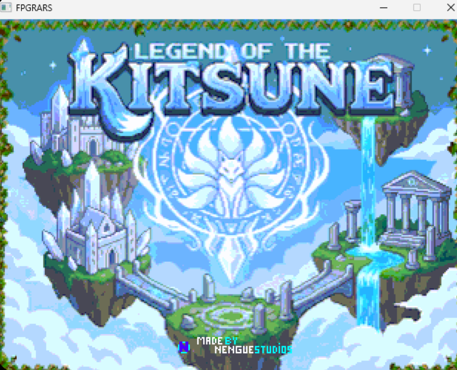
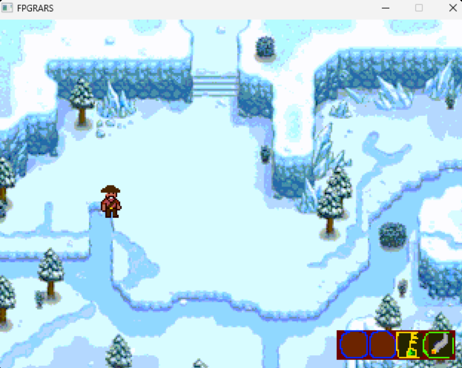
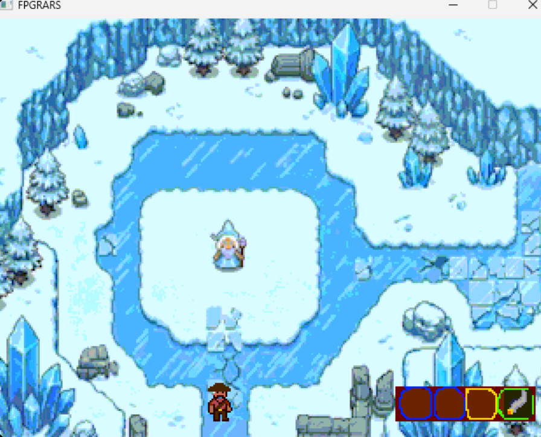
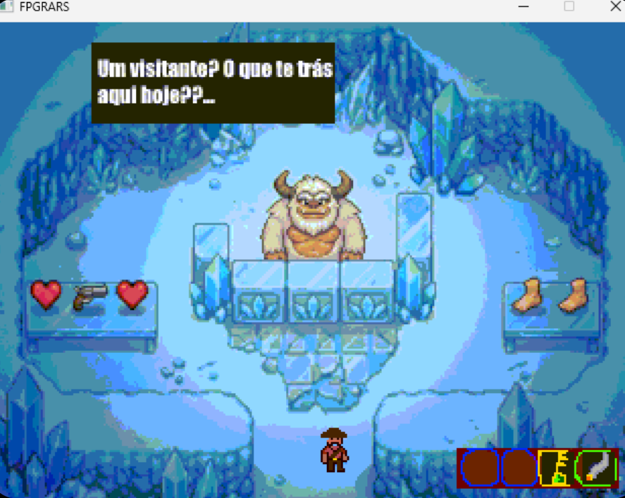
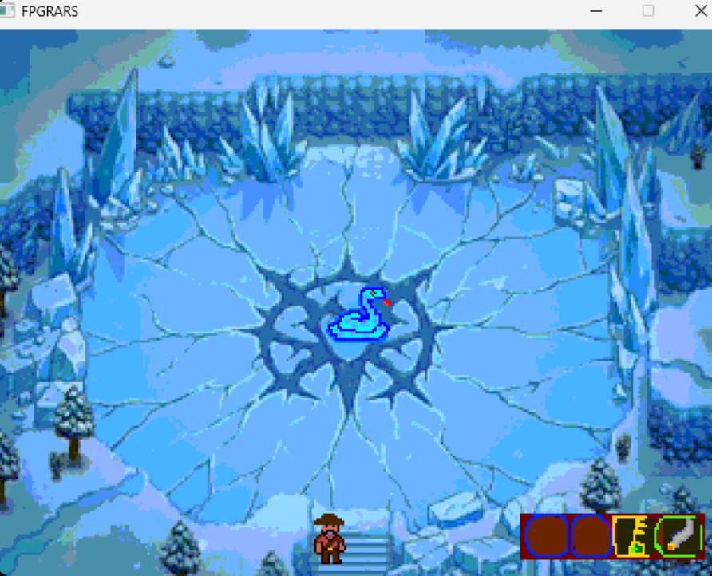

# 🦊 Legend of the Kitsune | RISC-V Assembly

Este é um RPG de aventura desenvolvido inteiramente em **Assembly RISC-V (RV32I)** para a disciplina de Organização de Computadores na **Universidade de Brasília (UnB)**.

  

## 🎮 Sobre o Projeto
O **Legend of the Kitsune** é um projeto de baixo nível que simula uma engine de jogo clássica rodando diretamente sobre o hardware via simulador **FPGRARS**. O desenvolvimento envolveu a criação de lógica para renderização de gráficos, gestão de memória e sistemas de entrada/saída (MMIO).

---

## 🖼️ Galeria / Gallery

|  |  |
| :---: | :---: |
| 🗺️ **Exploração e Mapas** | 💬 **Sistema de Diálogos e NPCs** |
|  |  |
| 🛒 **Interação com Cenário** | ⚔️ **Combate e Boss Fight** |

---

## 👾 Bestiário e Personagens / Bestiary & Characters

| Inimigo-NPC / Enemy-NPC | Comportamento / Behavior |
| :--- | :--- |
| 🐍 **Cobra** | Inimigo com ataque à distância e movimento circular |
| 👤 **Jagunço** | Protagonista com movimentação básica e ataque com espada |
| 🧊 **Rainha de Gelo** | **NPC interativa com diálogos de lore e história** |
| 👹 **Yeti (Loja)** | NPC comerciante e guardião de itens importantes |

---

## 🎮 Controles / Controls

| Ação / Action | Tecla / Key |
| :--- | :---: |
| Mover para cima / Move up | **W** |
| Mover para esquerda / Move left | **A** |
| Mover para baixo / Move down | **S** |
| Mover para direita / Move right | **D** |
| Atacar ou Interagir / Attack or Interact | **K** |

---

## ✨ Destaques Técnicos
* **Engine Gráfica:** Renderização via Bitmap Display (320x240) com suporte a transparência de sprites.
* **Gestão de Memória:** Uso direto do Heap de memória (`0xFF000000`) para renderização de frames em tempo real.
* **Mecânicas de RPG:** Implementação de detecção de colisões baseada em matrizes de tiles e sistema de inventário.
* **Áudio MIDI:** Trilha sonora polifônica integrada através de chamadas de sistema (syscalls).

---

## ⚙️ Requisitos Técnicos / Technical Requirements

> [!IMPORTANT]
> **Atenção:** Este projeto foi desenvolvido exclusivamente para o simulador **FPGRARS**. Ele **não funcionará** em outros simuladores (como o MARS) ou como um executável comum do Windows, pois depende das instruções específicas de hardware simulado pelo FPGRARS.

* **Simulador:** FPGRARS (Versão 1.4 ou superior).
* **Arquitetura:** RISC-V RV32I.
* **Bitmap Display:** 320x240 pixels.

---

## 📂 Estrutura do Projeto
* **`/src`**: Código-fonte principal (`main.s`) e lógica musical.
* **`/assets`**: Arquivos `.data` contendo sprites, menus e mapas.
* **`/Screenshots`**: Registros visuais das funcionalidades.
* **`/tools`**: Scripts Python para conversão de imagens para Assembly.
* **`/docs`**: Documentação oficial da disciplina.

---

## 🚀 Como Executar
1. Certifique-se de ter o **FPGRARS** instalado.
2. Em `Tools > Bitmap Display`, configure: **320x240**, Base Address: **0xFF000000**.
3. Abra o arquivo `src/main.s`, monte (F3) e execute (F5).

---

## 👥 Equipe / Team
* **Geovanne Junio** - Desenvolvedor Principal

---

  ⭐ Se você gostou deste projeto, considere dar uma estrela! / If you enjoyed this project, consider giving it a star!
   
  Feito com 💙 e muito Assembly | Made with 💙 and lots of Assembly

